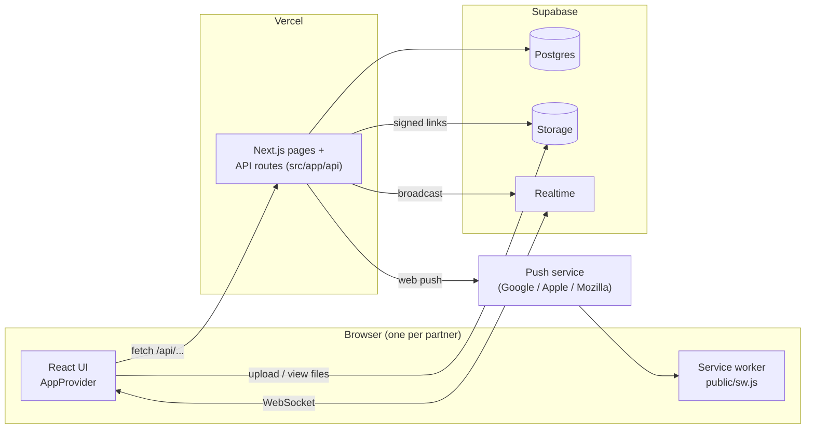

# 1. The big picture

## What the app does

Twogether is a chat app for exactly two people. It copies the core of WhatsApp (messages, photos, voice notes, ticks, calls) and adds couple features (days-together counter, hugs and kisses, moods, a daily question, countdowns, a bucket list). It installs on a phone like an app (PWA) and can send push notifications. It is built to run for free on **Vercel + Supabase**.

## The tech stack

| Layer | Technology | Why this one |
| --- | --- | --- |
| UI | React 19 + Next.js 16 (App Router) | Pages, layouts and API routes in one project |
| Styling | Tailwind CSS 4 | Utility classes; custom ones live in `src/app/globals.css` |
| Icons | `lucide-react` | SVG icons as React components |
| Emoji picker | `emoji-picker-react` | Search, skin tones, recents; uses the phone's own emoji |
| Hosting | Vercel | Runs Next.js natively; free for personal projects |
| Database | Supabase **Postgres**, via the `postgres` driver | Hosted, free tier, plain SQL |
| Files | Supabase **Storage** (private bucket `media`) | Photos, videos, voice notes; uploaded directly from the browser |
| Realtime | Supabase **Realtime** (Broadcast + Presence), via `@supabase/supabase-js` | Instant messages, ticks, typing, online status, call signalling |
| Push | `web-push` | Notifications to phones and browsers |
| Calls | WebRTC (built into browsers) | Audio and video go directly between the two phones |

## How the pieces talk



Three channels connect the browser to the backend:

1. **HTTP (`fetch /api/...`)** for everything that reads or changes data: send a message, save a mood, mark messages read. The API route works with Postgres and then broadcasts an event.
2. **Supabase Realtime** (a WebSocket run by Supabase) to receive events instantly, and to send typing and call signals straight to the partner.
3. **Supabase Storage**, directly, for file bytes: the browser uploads and downloads through short-lived signed links that our API hands out.

The rule to remember: **writes go through our API, notifications come back through Realtime.**

### Why not our own WebSocket server?

An earlier version had one (`server.ts` + `ws`). Vercel runs API routes as short-lived functions that cannot keep a socket open, keep files, or hold a database file. So the database, files and realtime moved to Supabase, and the app became a plain Next.js app that Vercel can host. Details in [14-deployment.md](14-deployment.md).

## Folder map

```text
twogether/
  next.config.ts             Next.js settings (security headers, dev origins)
  package.json               Scripts and dependencies
  .env.example               Settings to copy into .env.local
  supabase/schema.sql        All tables (run by npm run db:setup)
  docs/                      You are here
  scripts/
    db-setup.mjs             Creates the tables and the storage bucket in Supabase
    make-icons.mjs           Draws the PNG app icons with no dependencies
    make-share.mjs           Builds the copy-paste setup/update scripts
  public/
    sw.js                    Service worker (offline, caching, push)
    offline.html             Shown when offline and nothing is cached
    icons/                   App icons
  src/
    app/                     Next.js App Router: pages, layouts, API routes
      layout.tsx             Root HTML, theme script, service worker registration
      globals.css            Tailwind setup, colours, animations, custom utilities
      manifest.ts            PWA manifest
      (auth)/login, register Sign-in pages
      pair/                  Connect with your partner
      (app)/                 Signed-in and paired area
        layout.tsx           Loads you, partner, couple; wraps pages in AppProvider
        page.tsx             Chat (home)
        us/ moments/ settings/
      api/                   All REST endpoints (see 05-api-reference.md)
    server/                  Server-only code
      db.ts                  Postgres pool and query helpers
      supabase.ts            Supabase admin client: storage links, realtime broadcast
      realtime.ts            Channel names, sendToUser(s), isActive()
      auth.ts                Passwords, sessions
      api.ts                 Route helpers (errors, auth checks, rate limits)
      users.ts               User / couple rows -> JSON, toBootstrap()
      messages.ts            Message queries, building Message JSON, push previews
      push.ts                Web push and VAPID keys
      together.ts            Dates, bucket list, daily question queries
    lib/                     Shared code (server and browser)
      types.ts               All shared types and event shapes
      format.ts, limits.ts, questions.ts, wallpapers.ts, emoji.ts
      client/                Browser-only: api(), uploadFile(), supabaseBrowser(), push, sounds
    components/
      app/                   AppProvider (state + realtime), AppShell (nav), toasts, hearts
      chat/                  Everything on the chat screen
      call/                  CallProvider + call screen (WebRTC)
      us/ moments/ settings/ auth/ ui/
```

### Three kinds of code

| Folder | Runs where | Can use |
| --- | --- | --- |
| `src/server/` | Server only (Vercel functions) | Database, secret keys, `node:*` modules |
| `src/lib/` (except `client/`) | Both | Pure functions and types only |
| `src/lib/client/`, `src/components/` | Browser (`"use client"`) | `window`, `localStorage`, Realtime, camera, microphone |

Only variables starting with `NEXT_PUBLIC_` reach the browser. The database URL and the Supabase secret key never do.

## One request, end to end

What happens when you open the chat:

1. The browser asks Vercel for `/`.
2. `src/app/(app)/layout.tsx` runs on the server. It reads the session cookie and loads you, your partner and your couple from Postgres. No session: redirect to `/login`. No partner: redirect to `/pair`.
3. It renders `<AppProvider initial={toBootstrap(...)}>`. The bootstrap includes your two secret Realtime channel names.
4. In the browser, `AppProvider` fetches the latest 40 messages (`GET /api/messages`), marks new ones delivered, and subscribes to your private channel and the shared couple channel on Supabase Realtime.
5. From then on, new messages, ticks, typing and the online dot arrive through Realtime and update React state.

Continue with [02-running-the-app.md](02-running-the-app.md).
