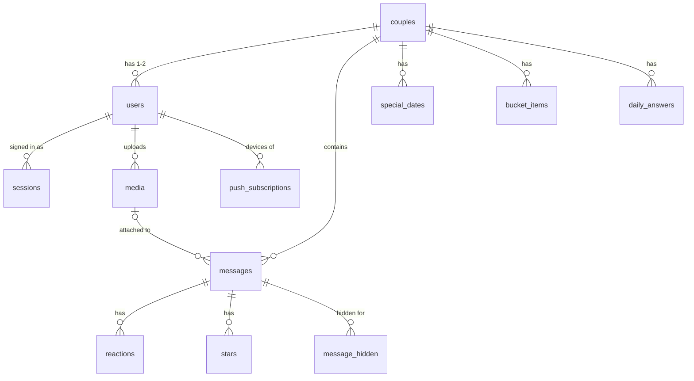

# 3. The database (Supabase Postgres)

All data lives in a Postgres database hosted by Supabase. Uploaded files live in Supabase Storage. The schema is `supabase/schema.sql`; the code that talks to the database is `src/server/db.ts`.

## How the connection works

```ts
return postgres(url, {
  prepare: false,              // required by Supabase's transaction pooler
  max: Number(process.env.DATABASE_POOL_MAX) || 3,
  types: { bigint: { ... parse: (v) => Number(v) } },
});
```

- The driver is [`postgres`](https://github.com/porsager/postgres) ("postgres.js"), small and fast.
- `DATABASE_URL` must be Supabase's **Transaction pooler** string (port 6543). Each Vercel function opens a few connections; the pooler shares a small number of real database connections between them. The pooler does not support prepared statements, hence `prepare: false`.
- Postgres returns `BIGINT` (our timestamps and `COUNT(*)`) as strings by default. The custom `bigint` type turns them into normal numbers.
- The pool is kept on `globalThis`, so hot reload in development does not open a new pool on every file save.

## Query helpers

Every query goes through these. They are all **async**: always `await` them.

| Helper | Returns | Example |
| --- | --- | --- |
| `one<T>(sql, ...params)` | First row or `undefined` | `await one<UserRow>("SELECT * FROM users WHERE id = ?", id)` |
| `all<T>(sql, ...params)` | Array of rows | `await all<MessageRow>("SELECT * FROM messages WHERE couple_id = ?", coupleId)` |
| `run(sql, ...params)` | `{ changes }` | `await run("UPDATE users SET name = ? WHERE id = ?", name, id)` |
| `insert(sql, ...params)` | The new row's `id` | `await insert("INSERT INTO bucket_items (...) VALUES (?, ?)", a, b)` |
| `tx(async (db) => ...)` | Whatever you return | Transaction; `db` has the same four helpers. Rolls back if anything throws. |

We write `?` placeholders because they are easy to read. `toPg()` turns them into Postgres's `$1, $2, ...` before sending. So **never put a literal `?` inside SQL text**. Pass values as parameters instead, which is also what protects against SQL injection.

`kvGet` / `kvSet` read and write the `kv` table (currently only the generated push keys).

## Setting it up

`npm run db:setup` (`scripts/db-setup.mjs`) runs `supabase/schema.sql` and creates the private Storage bucket `media`. Every statement uses `IF NOT EXISTS`, so it is safe to run again. See [14-deployment.md](14-deployment.md).

## Tables



Times are **milliseconds since 1970** in `BIGINT` columns (`Date.now()`), except dates the user picks, which are `YYYY-MM-DD` text. Ids are `INTEGER GENERATED BY DEFAULT AS IDENTITY` (auto-increment).

### `users`

| Column | Meaning |
| --- | --- |
| `email` | Unique, always stored in lowercase |
| `name` | Display name |
| `password_hash` | `scrypt:<salt>:<hash>`, never the real password |
| `avatar_media_id` | Profile photo (`media.id`) |
| `partner_nickname` | What **this** user calls their partner. Private to them. |
| `mood_emoji`, `mood_text`, `mood_at` | Current mood |
| `couple_id` | Their couple, `NULL` if none |
| `last_seen` | Last heartbeat or sign of life |
| `active_until` | App counts as on screen until this time (heartbeat, see [06](06-realtime-websocket.md#push-or-no-push-the-heartbeat)) |
| `channel_key` | Secret name of this user's private Realtime channel |

### `couples`

| Column | Meaning |
| --- | --- |
| `invite_code` | 6 characters while waiting for a partner, `NULL` once paired |
| `anniversary` | `YYYY-MM-DD` |
| `wallpaper` | Chat background id (`src/lib/wallpapers.ts`) |
| `channel_key` | Secret name of the couple's shared Realtime channel |

### `sessions`

One row per signed-in browser. `token_hash` is the SHA-256 of the cookie value, so a leaked database contains no working cookies. Expires after 60 days.

### `messages`

| Column | Meaning |
| --- | --- |
| `couple_id`, `sender_id` | Which chat, who sent it |
| `client_id` | Random id from the browser. Unique per sender, so retries never create duplicates. |
| `type` | `text`, `image`, `video`, `audio`, `file`, `nudge`, `call`, `system` |
| `body` | Text, caption, or the nudge kind |
| `media_id` | Attached file |
| `meta` | JSON text: image `w`/`h`, `duration`, voice `peaks`, call `video`/`status` |
| `reply_to` | Message being replied to |
| `view_once`, `viewed_at` | View-once flag and when it was opened |
| `edited_at`, `deleted_at` | Edit and "delete for everyone" |
| `created_at`, `delivered_at`, `read_at` | The ticks |

There is one row per message, not one per recipient: a chat has exactly two people, so `delivered_at` and `read_at` always refer to the partner.

### Around messages

| Table | Purpose |
| --- | --- |
| `message_hidden` | "Delete for me" and "Clear chat". Every list query filters these out for the viewer. |
| `reactions` | One emoji per user per message. Reacting again replaces it. |
| `stars` | Starred messages, private per user |

### `media`

One row per uploaded file: `file` is the object path in the Storage bucket (`<userId>/<uuid>.<ext>`), plus `mime`, original `name`, `size` and `uploader_id`. The app URL is `/api/media/<id>`, which redirects to a short-lived signed Storage link.

### Couple features, push, settings, limits

| Table | Purpose |
| --- | --- |
| `special_dates` | Countdowns. `yearly = 1` repeats every year. |
| `bucket_items` | Bucket list. `done_at` / `done_by` when ticked. |
| `daily_answers` | One answer per user per day (primary key stops double answers) |
| `push_subscriptions` | One row per device that allowed notifications |
| `kv` | Server settings (the generated push keys) |
| `rate_limits` | Attempt counters for sign-up, sign-in and pairing. In the database because serverless functions share no memory. |

### Row Level Security

The schema turns on **Row Level Security** for every table and adds **no policies**. Supabase also exposes a public REST API on your tables, and RLS with no policies means that API returns nothing to anyone. Our server is not affected: it connects with the database password, which bypasses RLS.

## From row to JSON

The database row and what the browser receives differ on purpose:

- `src/server/users.ts`: `toPublicUser`, `toMe`, `toCouple`, and `toBootstrap` (which also adds your secret Realtime channel names).
- `src/server/messages.ts` `hydrate(rows, viewerId)`: adds reactions, the viewer's stars, reply previews and media info in a few queries. Deleted messages lose body, media and reactions. View-once messages get an empty media URL.

## Changing the schema

1. Edit `supabase/schema.sql`. New table: add a `CREATE TABLE IF NOT EXISTS`. New column on an existing table: add it to the `CREATE TABLE` **and** add a line that works on existing databases:

   ```sql
   ALTER TABLE users ADD COLUMN IF NOT EXISTS birthday TEXT;
   ```

2. Run `npm run db:setup` (or paste the new lines into Supabase **SQL Editor**).
3. Add the column to the row type (e.g. `UserRow` in `src/server/users.ts`).
4. For a new table, add `ALTER TABLE ... ENABLE ROW LEVEL SECURITY;` too.

## Looking at the data

Supabase dashboard, **Table Editor**: browse and edit rows. **SQL Editor**: run any query, for example:

```sql
SELECT id, sender_id, type, body, to_timestamp(created_at / 1000) AS sent
FROM messages ORDER BY id DESC LIMIT 20;
```

Uploaded files are under **Storage > media**.

Continue with [04-auth-and-pairing.md](04-auth-and-pairing.md).
