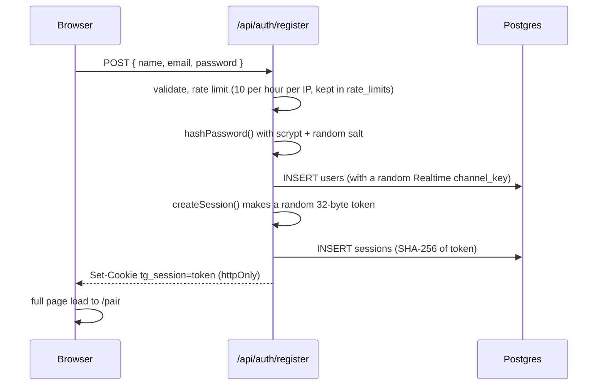
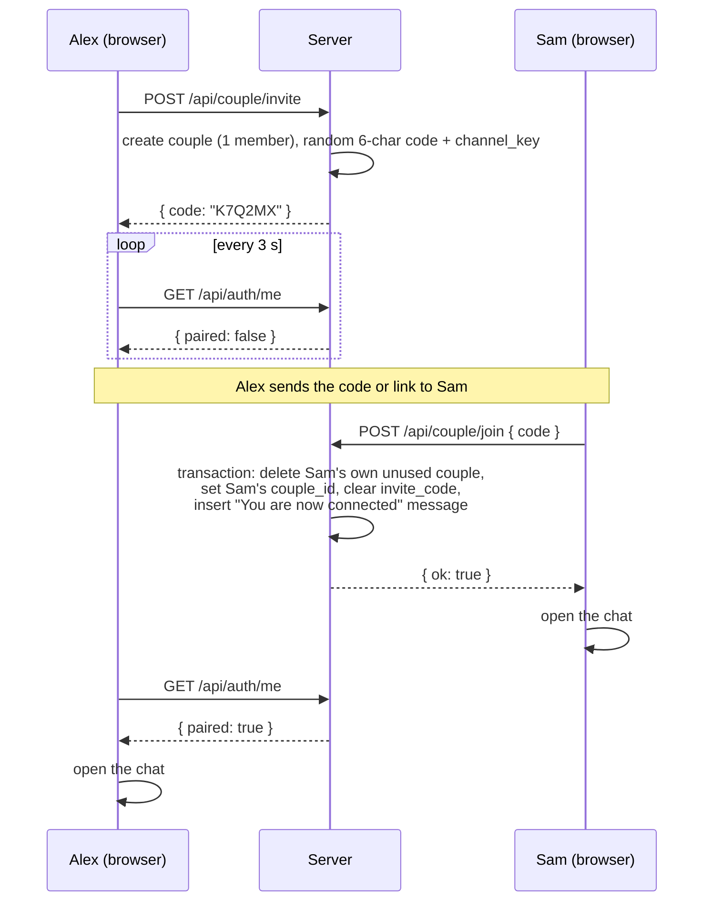

# 4. Accounts, sessions and pairing

## Sign up and sign in

Files: `src/components/auth/AuthForm.tsx` (form), `src/app/api/auth/register/route.ts`, `src/app/api/auth/login/route.ts`, `src/server/auth.ts`.

Login is the same, except it looks the user up by email and checks the password with `verifyPassword()`. Wrong email and wrong password give the **same** message ("Wrong email or password"), so nobody can use the form to find out which emails have accounts. Login is limited to 8 tries per 15 minutes per IP and email.

### Passwords

`hashPassword()` uses **scrypt** (built into Node's `crypto`). scrypt is deliberately slow and memory-hungry, which makes guessing passwords from a stolen database expensive. The stored value looks like `scrypt:<16-byte salt in hex>:<64-byte hash in hex>`. `verifyPassword()` hashes the attempt with the same salt and compares with `timingSafeEqual` (constant-time, so response timing reveals nothing).

### Sessions and the cookie

- The cookie `tg_session` holds a random token. It is `httpOnly` (JavaScript in the page cannot read it), `sameSite: lax` (other sites cannot make your browser send it on their forms), and `secure` when the site is on https.
- The database only stores the SHA-256 of the token.
- `userFromToken(token)` hashes the cookie and joins `sessions` to `users`. It is the one function every auth check ends up calling.

Where the check happens:

| Place | How it gets the token |
| --- | --- |
| Pages and layouts | `currentUser()` in `src/server/api.ts`, which uses Next.js `cookies()` |
| API routes | `requireUser()` / `requireCouple()`, which call `currentUser()` and throw `HttpError(401 or 409)` |
| Realtime | No cookie check: the page data gives each signed-in user their secret channel names (`toBootstrap()`), see [06](06-realtime-websocket.md) |

Sign out (`POST /api/auth/logout`) deletes the session row and the cookie. The Settings page also removes this device's push subscription and clears cached pages and media first.

### Why sign-in uses `window.location.href` and not the router

After the cookie changes, the server layouts must run again with the new cookie. A full page load guarantees that. That's why the ESLint rule `no-location-assign-relative-destination` is turned off in `eslint.config.mjs`.

## Route protection

There is no `proxy.ts` (the file Next.js 16 uses instead of the old `middleware.ts`). Each area protects itself in its layout:

| Layout | Rule |
| --- | --- |
| `src/app/(auth)/layout.tsx` | Already signed in? Redirect to `/`. |
| `src/app/pair/page.tsx` | Not signed in? Redirect to `/register?next=/pair...`. Already paired? Redirect to `/`. |
| `src/app/(app)/layout.tsx` | Not signed in: `/login`. No partner yet: `/pair`. |

The folders in brackets, `(auth)` and `(app)`, are **route groups**: they share a layout but do not appear in the URL. `/login` is `src/app/(auth)/login/page.tsx`.

API routes do their own checks with `requireUser()` (signed in) or `requireCouple()` (signed in **and** paired). `requireCouple()` returns `{ user, partner, coupleId }`, which most routes need anyway.

## Pairing two people

Files: `src/components/auth/PairView.tsx`, `src/app/api/couple/invite/route.ts`, `src/app/api/couple/join/route.ts`.

Rules enforced by `join`:

- The code must exist and its couple must have **exactly one** member (so a code cannot be reused once two people are in).
- You cannot join your own code.
- You cannot join while already paired.
- 20 tries per 15 minutes per IP, so codes cannot be guessed by brute force. The alphabet skips look-alike characters (`0/O`, `1/I`).

The invite link is `/pair?code=K7Q2MX`. If Sam opens it without an account, the pair page sends them to `/register?next=/pair?code=K7Q2MX`, and after signing up they come back with the code already filled in. `AuthForm` only accepts `next` values that start with a single `/`, so the link cannot send people to another website.

## Unlinking

`DELETE /api/couple` with `{ "confirm": "UNLINK" }` deletes the couple row. Because of `ON DELETE CASCADE`, that removes all messages, dates, bucket items and answers. The route also deletes the uploaded files of those messages from disk, sets both users' `couple_id` to `NULL`, and sends `unpaired` over the WebSocket, which sends both browsers back to `/pair`.

Continue with [05-api-reference.md](05-api-reference.md).
