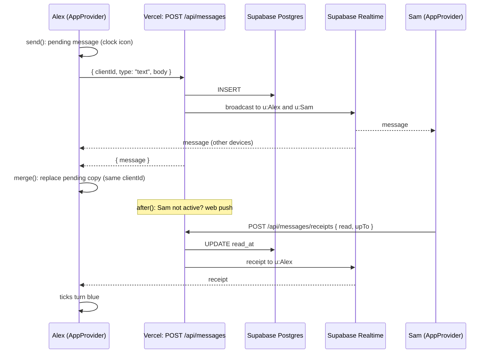

# 6. Realtime with Supabase

Files: `src/server/realtime.ts` (server publishes), `src/server/supabase.ts` (the HTTP call), `src/components/app/AppProvider.tsx` (browser listens), `src/lib/client/supabase.ts` (browser client), `src/lib/types.ts` (event shapes).

## Why Supabase Realtime

On Vercel, API routes are short-lived functions: they start, answer, and stop. A WebSocket needs a process that stays alive, so we hand that job to **Supabase Realtime**, a hosted WebSocket service. We use two of its features:

| Feature | What it does | Used for |
| --- | --- | --- |
| **Broadcast** | Send a message to everyone subscribed to a channel | New messages, edits, ticks, typing, call signals |
| **Presence** | Every subscriber shares a small state; everyone sees who is there | The green "online" dot |

## The two channels

Every couple uses two kinds of channel. A channel is just a name (a "topic"):

| Channel | Name | Who listens | Who sends | Carries |
| --- | --- | --- | --- | --- |
| **Private user channel** | `u:<users.channel_key>` | Only that user's browsers | Only our server | `message`, `message:update`, `message:hidden`, `receipt`, `refresh`, `unpaired` |
| **Shared couple channel** | `c:<couples.channel_key>` | Both partners' browsers | The browsers themselves | `typing`, `call` signals, and presence |

`channel_key` is 24 random bytes created at sign-up / pairing (`newChannelKey()`). The browser learns its channel names from the page data after sign-in (`Bootstrap.realtime` in `toBootstrap()`), and nobody else ever sees them. Knowing the name is what lets you listen, so the names are secrets. See [12](12-security.md) for the reasoning.

## Server to browser

```ts
// in an API route, after writing to the database
await sendToUsers([user.id, partner.id], { t: "refresh", what: "bucket" });
```

`sendToUsers()` looks up each user's `channel_key` and calls `broadcast()` in `src/server/supabase.ts`, which makes one HTTPS request:

```http
POST https://<project>.supabase.co/realtime/v1/api/broadcast
apikey: <secret key>
{ "messages": [{ "topic": "u:abc...", "event": "event", "payload": { "t": "refresh", "what": "bucket" } }] }
```

`sendEach()` sends a **different** payload to each user in one request. `publishMessage()` uses it because each partner gets their own view of a message (stars are private).

The routes `await` the broadcast before answering, so when your `fetch` returns, the event is already on its way.

## Browser side

`AppProvider` opens both channels once:

```ts
const mine = sb.channel(userTopic);
mine.on("broadcast", { event: "event" }, ({ payload }) => onEvent(payload));
mine.subscribe((state) => { /* SUBSCRIBED -> "online"; after a reconnect, sync() */ });

const shared = sb.channel(coupleTopic, { config: { broadcast: { self: false }, presence: { key: tabKey } } });
shared.on("broadcast", { event: "peer" }, ({ payload }) => onPeer(payload));
shared.on("presence", { event: "sync" }, updateOnlineDot);
shared.subscribe((state) => { if (state === "SUBSCRIBED") shared.track({ userId: meId }); });
```

- `self: false`: you do not receive your own typing and call messages back.
- Presence key = `<userId>:<random per tab>`, so two tabs of the same person count separately. The partner is "online" when any presence entry has their `userId`.
- `supabase-js` reconnects by itself. When the private channel is `SUBSCRIBED` again, `sync()` fetches what was missed.
- **Fallback:** while the channel is not connected, the app fetches new messages every 10 s, so the chat still works (just slower) if Realtime is blocked or the project is paused.

## Events

Exact types: `ServerEvent` and `PeerEvent` in `src/lib/types.ts`.

### Server to user (private channel, event name `event`)

| Event | Sent when |
| --- | --- |
| `message` | New message (to both partners, including the sender's other devices) |
| `message:update` | Edit, delete for everyone, reaction, star, view-once opened |
| `message:hidden` | You deleted for yourself or cleared the chat (only you) |
| `receipt` | `delivered` or `read`, with `upTo`, `at`, `readerId` |
| `refresh` | `couple`, `dates`, `bucket` or `question` changed: re-fetch it |
| `unpaired` | The couple was unlinked |

### Partner to partner (couple channel, event name `peer`)

| Event | Meaning |
| --- | --- |
| `{ t: "typing", from, state }` | `typing`, `recording` or `null` |
| `{ t: "call", from, data }` | WebRTC signalling (see [09](09-calls-webrtc.md)) |

`from` is the sender's user id. Your own other devices also receive your `peer` events (only the sending tab is excluded), which the call code uses to stop ringing on your laptop when you answer on your phone.

## The ticks

| Tick | Column | Set by |
| --- | --- | --- |
| Clock | (none) | Still sending |
| One grey | `created_at` | `POST /api/messages` |
| Two grey | `delivered_at` | The **receiver's browser** calls `POST /api/messages/receipts { kind: "delivered" }` when the message reaches it (live, on load, or after a reconnect) |
| Two blue | `read_at` | The receiver's browser calls `POST /api/messages/receipts { kind: "read" }` when the chat is open and visible |

The receipts route updates the rows and broadcasts `receipt` to the sender (and, for `read`, to the reader's other devices, which clears their unread badge).

## Push or no push: the heartbeat

The server needs to know whether the partner is looking at the app, so it does not send a notification they would see anyway. Supabase presence lives in the browser, so the server uses a simple heartbeat instead:

- While visible, the browser calls `POST /api/presence { visible: true }` every 25 s. The server sets `users.active_until = now + 60 s` and `last_seen = now`.
- When the tab is hidden or closed, `navigator.sendBeacon` sends `{ visible: false }`, which sets `active_until = 0`.
- `isActive(userId)` is `active_until > now`. `notifyPartner()` only pushes when it is false.

The push itself runs inside Next.js `after()`, which runs after the response has been sent. So the sender never waits for Google's or Apple's push service.

## The life of one message



In the code:

1. `Composer.tsx` `submitText()` calls `send()`.
2. `AppProvider` `send()` adds a pending message (negative id, new `clientId`) and calls `deliver()`, which uploads any file and then `POST /api/messages`.
3. The route validates, inserts, `publishMessage()` broadcasts to both partners, and `notifyPartner()` schedules a push.
4. Both browsers receive `message` in `onEvent()` and `merge()` it. For the sender, `merge()` swaps the pending copy for the real one by `clientId`, so it never shows twice.
5. Sam's browser marks it read (chat open) or delivered (chat not open), and Alex's ticks update on `receipt`.

If the POST fails, the bubble shows "Not sent. Tap to retry", and `retry()` resends with the same `clientId`, so the server never stores it twice (the unique index on `(sender_id, client_id)` guarantees that).

Continue with [07-frontend-architecture.md](07-frontend-architecture.md).
