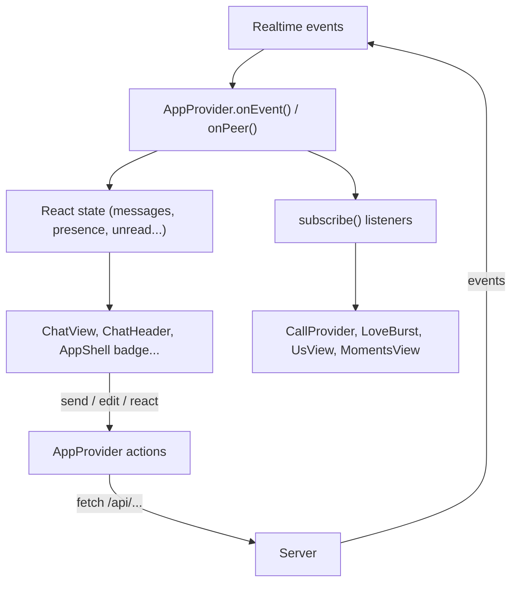

# 7. Frontend architecture

## Pages and layouts

```text
src/app/layout.tsx                 <html>, theme script, <PwaRegister/>
  (auth)/layout.tsx                pink background + logo; redirects if signed in
    login/page.tsx                 <AuthForm mode="login"/>
    register/page.tsx              <AuthForm mode="register"/>
  pair/page.tsx                    <PairView/>
  (app)/layout.tsx                 loads me/partner/couple -> <AppProvider><AppShell>
    page.tsx            "/"        <ChatView/>
    us/page.tsx         "/us"      <UsView/>
    moments/page.tsx    "/moments" <MomentsView initialTab/>
    settings/page.tsx   "/settings"<SettingsView/>
```

`page.tsx` and `layout.tsx` files are **server components**: they run on the server, can read cookies and the database, and send HTML. The real UI lives in `src/components/**`, which are **client components** (first line `"use client"`), so they can use state, effects and browser APIs.

Next.js 16 details used here:

- `searchParams` and `params` are Promises: `const { tab } = await searchParams`.
- `cookies()` from `next/headers` is async: `(await cookies()).get(...)`.
- `export const metadata` sets the `<title>`; `export const viewport` sets theme colour and zoom behaviour.

## The two providers

```text
AppProvider        (src/components/app/AppProvider.tsx)
  CallProvider     (src/components/call/CallProvider.tsx)
    AppShell       nav rail on desktop, bottom tabs on phones
      page content
    Toasts, LoveBurst, CallOverlay
```

Both are React **contexts**. Any component inside can call `useApp()` or `useCall()`.

### `AppProvider`: the brain of the client

It owns everything that more than one screen needs, and it is the **only** place that talks to Supabase Realtime (see [06](06-realtime-websocket.md#browser-side)).

**State it holds:**

| State | Meaning |
| --- | --- |
| `me`, `partner`, `couple` | Starts from the server layout, refreshed on `refresh: couple` |
| `partnerName` | Your nickname for the partner, or their name |
| `status` | `connecting` / `online` / `offline` (your socket) |
| `partnerOnline`, `partnerLastSeen`, `partnerTyping` | Header status line |
| `messages` | The loaded slice of the chat, oldest first, pending ones at the end |
| `loaded`, `hasMore`, `hasNewer` | Pagination flags. `hasNewer` is true after jumping into the past. |
| `unread` | Badge count |
| `toasts` | Small pop-up notices |

**Actions it exposes:**

| Action | Does |
| --- | --- |
| `send(draft)` | Optimistic send: pending message, upload, POST, replace |
| `retry(clientId)`, `discard(clientId)` | For failed sends |
| `edit`, `remove`, `react`, `star` | Call the API (react and star update the screen first, then the server confirms) |
| `loadOlder()` | Next 40 older messages |
| `jumpTo(id)`, `backToLatest()` | Load around a message / return to the newest |
| `markRead()`, `setChatActive(bool)` | Read receipts (`POST /api/messages/receipts`) |
| `setTyping(state)` | Sends typing to the partner on the couple channel, at most every 3 s |
| `sendSignal(data)` | Call signalling on the couple channel |
| `subscribe(fn)` | Listen to every server event (used by calls, the hearts animation, Us and Moments pages) |
| `refreshCouple()`, `patchMe(me)` | Update profile data |
| `toast(...)` | Show a notice |

**Why messages live here and not in `ChatView`:** if you open the Us tab and come back, the chat is still loaded, and messages that arrive while you are on another tab still update the unread badge.

### `subscribe()`: an event bus

Components that only care about some events subscribe:

```ts
useEffect(
  () => subscribe((e) => {
    if (e.t === "refresh" && e.what === "bucket") void load();
  }),
  [load, subscribe],
);
```

`subscribe` returns the unsubscribe function, so returning it from `useEffect` cleans up. Besides server events there is one local event, `local:nudge`, fired by `send()` and by incoming nudges, which `LoveBurst` turns into floating hearts.

## Data flow in one picture



## Patterns you will see everywhere

### 1. Refs that mirror state

```ts
const messagesRef = useRef(messages);
useEffect(() => {
  messagesRef.current = messages;
}, [messages]);
```

The Realtime channels are opened once, but their handlers need the *latest* state. Reading `messagesRef.current` inside callbacks gives the current value without re-subscribing. The same is done for `onEventRef`, `onPeerRef`, `hasNewerRef` and `markReadRef`.

### 2. Functional state updates

```ts
setMessages((list) => merge(list, [message]));
```

Always update lists from the previous value. Events can arrive faster than React renders.

### 3. `useHydrated()` for browser-only values

```ts
const useHydrated = () => useSyncExternalStore(noop, () => true, () => false);
```

It returns `false` on the server and during hydration, and `true` afterwards. Use it when the output depends on the browser: dates in the user's time zone, `localStorage`, `navigator`. Without it, the server HTML and the first browser render differ and React reports a **hydration mismatch**. Examples: `ChatView` only renders `<Composer>` when hydrated (the composer reads the saved draft from `localStorage`); `SettingsView` returns `null` until hydrated (theme and sound preferences come from `localStorage`).

### 4. Adjusting state while rendering

```ts
const [editingShown, setEditingShown] = useState(editing);
if (editing !== editingShown) {
  setEditingShown(editing);
  if (editing) setText(editing.body ?? "");
}
```

This is React's recommended way to reset state when a prop changes, instead of `useEffect(() => setText(...), [editing])`. The project's ESLint config (React Compiler rules from `eslint-config-next`) **rejects** `setState` called directly inside an effect, so you will meet this rule if you add such code.

Other compiler rules you may hit:

| Error | Fix |
| --- | --- |
| "Calling setState synchronously within an effect" | Compute during render, use the pattern above, or set state inside a `.then()` / event callback |
| "Cannot access refs during render" | Only read `ref.current` in event handlers and effects |
| "Cannot call impure function during render" (`Date.now()`) | Capture it once: `const [now] = useState(() => Date.now())`, as `MessageMenu` does |

### 5. Optimistic UI

`send()`, `react()` and `star()` change the screen first, then call the server. If the server disagrees, the next `message:update` event corrects it.

## Styling

- Tailwind 4 is configured **in CSS**, not in a `tailwind.config.js`. Look at `src/app/globals.css`:
  - `@theme { ... }` defines extra colours (`night`, `night-2`, `night-3`) and animations (`animate-pop`, `animate-float-heart`, `animate-beat`...).
  - `@utility btn-primary { @apply ... }` defines reusable classes: `card`, `btn`, `btn-primary`, `btn-soft`, `btn-ghost`, `btn-danger`, `icon-btn`, `field`, `label`, plus `pt-safe` / `pb-safe` for the phone notch and `h-app` for full screen height.
- **Dark mode** uses a `dark` class on `<html>` (`@custom-variant dark`). An inline script in `src/app/layout.tsx` sets it before the page paints, from `localStorage["tg-theme"]` (`light`, `dark` or `system`), so dark mode never flashes white.
- **Wallpapers** (`src/lib/wallpapers.ts`) are CSS backgrounds: a tiled SVG of hearts over a gradient, one version for light and one for dark. `ChatView` passes both as CSS variables and picks with `dark:`.

## Small shared UI pieces

| Component | Use |
| --- | --- |
| `ui/Avatar` | Photo or coloured initials, optional online dot |
| `ui/Sheet` | Bottom sheet on phones, dialog on desktop. Closes on Escape and backdrop click, moves focus inside. |
| `ui/Spinner` | Loading indicator |
| `app/Toasts` | The pop-up notices from `toast()` |
| `app/LoveBurst` | Floating hearts on nudges (skipped when the OS asks for reduced motion) |

## Browser-only helpers (`src/lib/client/`)

| File | Contents |
| --- | --- |
| `api.ts` | `api()` fetch wrapper, `uploadFile()` with progress, `prepareImage()` (re-saves photos larger than 2048 px or 1.5 MB as JPEG, max 2048 px; GIFs untouched), `probeVideo()` (reads video size and length) |
| `push.ts` | `enablePush()`, `disablePush()`, `currentSubscription()` |
| `sound.ts` | Synthesised sounds (message, sent, nudge, ringtone) with the Web Audio API, so there are no audio files. Off when `localStorage["tg-sound"] = "off"`. |

Continue with [08-chat-features.md](08-chat-features.md).
