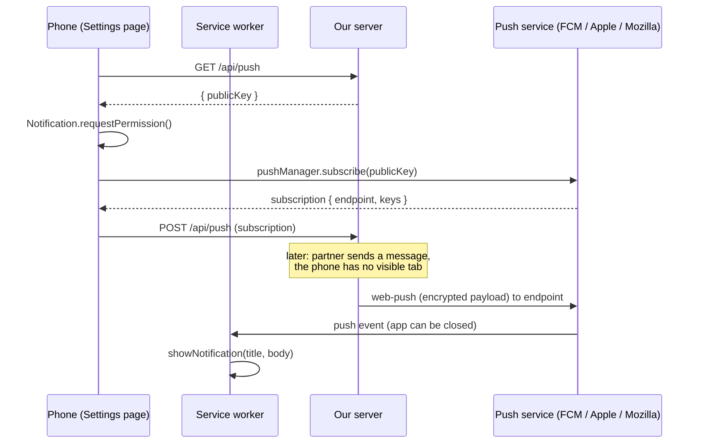

# 10. PWA, offline and push notifications

A **PWA** (Progressive Web App) is a website the browser lets you install. It gets an icon on the home screen, opens without browser bars, can work offline and can receive push notifications. Three things make Twogether a PWA:

1. A **manifest**: `src/app/manifest.ts`, served as `/manifest.webmanifest`
2. A **service worker**: `public/sw.js`
3. **https** (or localhost)

## The manifest

`manifest.ts` returns the app's name, colours, `display: "standalone"` (no browser bars), start URL, shortcuts (Chat, Us), and three icons from `public/icons/`. The **maskable** icon has extra padding so Android can crop it into a circle or squircle. `src/app/apple-icon.png` and `src/app/icon.svg` are picked up by Next.js automatically for iPhone and the browser tab.

Installing:

- **Android / desktop Chrome / Edge:** the browser offers "Install app". Settings also has an **Install Twogether** button that uses the `beforeinstallprompt` event when the browser fires it.
- **iPhone:** Safari, Share, **Add to Home Screen**. Settings shows these instructions on iOS.

## The service worker

A service worker is a script the browser runs **in the background**, separate from the page. It can intercept the page's network requests and receive push messages even when no tab is open.

`src/components/app/PwaRegister.tsx` registers it. In development it registers `/sw.js?dev=1`, and the worker sees `dev` and turns caching off, so you always get fresh code while developing.

### Caching strategy (`fetch` handler)

| Request | Strategy | Why |
| --- | --- | --- |
| `/_next/static/*`, `/icons/*` | Cache first (keep 300) | Build files have unique names and never change |
| Page navigations | Network first, then the cached copy of that page, then `/offline.html` | Fresh when online, still opens when offline |
| Everything else (API calls) | Not touched | Data must be live |

Cache names start with a version (`tg-v1`). On `activate`, caches from other versions are deleted. **When you change the caching logic, bump `VERSION`** in `sw.js`.

On sign-out, `clearOfflineData()` deletes the cached pages and media so the next person on that device sees nothing.

## Push notifications

### The pieces

| Piece | Where |
| --- | --- |
| VAPID keys (identify our server to push services) | `src/server/push.ts`: from `.env`, or generated once and stored in the `kv` table |
| Subscribe in the browser | `src/lib/client/push.ts` `enablePush()`, called from Settings |
| Store subscriptions | `push_subscriptions` table, `POST /api/push` |
| Send | `pushToUser()` in `src/server/push.ts` using the `web-push` library |
| Show | `push` handler in `public/sw.js` |
| Tap | `notificationclick` in `public/sw.js`: focus an open window or open one |

### Flow

The payload is `{ title, body, tag, url, icon }`. `tag` groups notifications: new chat messages replace the previous chat notification instead of stacking up. Nudges vibrate in a heartbeat pattern.

What triggers a push:

| Event | Code |
| --- | --- |
| New message, nudge, missed call | `notifyPartner()` in `src/server/messages.ts` |
| Partner answered the daily question | `src/app/api/question/route.ts` |
| Test button in Settings | `PUT /api/push` |

Push is skipped when the partner has the app visible (`isActive()`, based on the heartbeat in [06](06-realtime-websocket.md#push-or-no-push-the-heartbeat)), and the service worker skips it again if a focused window exists. Sending runs in Next.js `after()`, after the API response, so it never slows the sender down.

If a push service says a subscription is gone (HTTP 404 or 410), the server deletes it.

### iPhone notes

iOS only supports web push for apps **added to the Home Screen** (iOS 16.4+), and only when opened from there. In Safari tabs, Settings explains this instead of showing the switch.

## Offline behaviour

- The app opens offline if you opened it before (cached page and static files).
- Photos come from Supabase through 1-hour signed links; the browser's normal cache keeps recently seen ones.
- New messages cannot be sent offline. They show "Not sent. Tap to retry". Realtime reconnects by itself when the network returns, and missed messages are fetched.
- With nothing cached, `public/offline.html` is shown.

Continue with [11-couple-features.md](11-couple-features.md).
