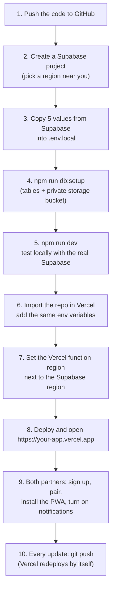
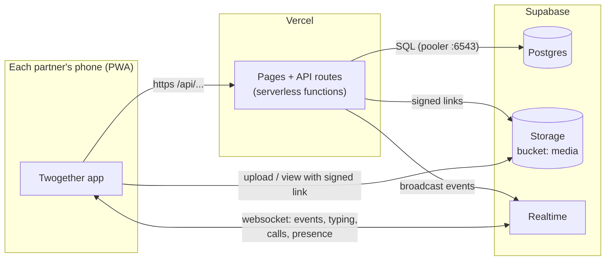

# 14. Deploying for free: Vercel + Supabase

Twogether runs on two free services:

| Service | Provides | Free plan, as of October 2026 (check their pricing pages) |
| --- | --- | --- |
| **Vercel** (Hobby) | Hosts the Next.js app: pages, API routes, https, global CDN | Non-commercial use only. Generous request and bandwidth limits for two people. |
| **Supabase** (Free) | Postgres database, file storage, Realtime (live events) | 500 MB database, about 1 GB files, 50 MB per file, 200 live connections. **A project pauses after 7 days with no activity** (data is kept; press Restore in the dashboard). Daily use keeps it awake. |

You need: a GitHub account, a Vercel account and a Supabase account. All three have free sign-up with GitHub.

## Roadmap



## How the pieces fit in production



Why each part is needed: Vercel functions start and stop per request, so they cannot keep a WebSocket open, write files that last, or hold a database file. Supabase does those three jobs. See [06](06-realtime-websocket.md) for how realtime works.

## Step by step

### 1. Put the code on GitHub

```bash
cd twogether
git init
git add .
git commit -m "Twogether"
```

Create an empty **private** repository on github.com, then:

```bash
git remote add origin https://github.com/YOUR-NAME/twogether.git
git branch -M main
git push -u origin main
```

`.env.local`, `data/`, `node_modules` and `twogether-share/` are in `.gitignore`, so secrets are not pushed.

### 2. Create the Supabase project

1. supabase.com, **New project**.
2. Name it `twogether`. Choose a strong **database password** and save it in a password manager; you need it in step 3.
3. **Region:** the one closest to you (for India: Mumbai, `ap-south-1`). Remember it for step 7.
4. Wait about 2 minutes until the project is ready.

### 3. Collect the five values

Create `.env.local` in the project folder (copy `.env.example`) and fill in:

| Variable | Where in Supabase |
| --- | --- |
| `DATABASE_URL` | Top bar **Connect**, then **Transaction pooler** (port **6543**). Replace `[YOUR-PASSWORD]` with the database password. |
| `SUPABASE_URL` | **Project Settings > API** (or **Data API**): Project URL, e.g. `https://abcd.supabase.co` |
| `SUPABASE_SERVICE_ROLE_KEY` | **Project Settings > API Keys**: the **secret** key (`sb_secret_...`) or the legacy `service_role` key. **Server only, never share it.** |
| `NEXT_PUBLIC_SUPABASE_URL` | Same as `SUPABASE_URL` |
| `NEXT_PUBLIC_SUPABASE_ANON_KEY` | **API Keys**: the **publishable** key (`sb_publishable_...`) or the legacy `anon` key. Safe in the browser. |

Use the **Transaction pooler** string, not the "Direct connection". Serverless functions open many short connections; the pooler shares a few real ones between them.

Also check **Realtime** is on (**Project Settings > Realtime**). If you see **"Allow public access"**, leave it enabled. Twogether uses secret channel names, not Supabase Auth (see [12](12-security.md)).

### 4. Create the tables and the bucket

```bash
npm install
npm run db:setup
```

It runs `supabase/schema.sql` and creates the private `media` bucket. It should end with "Supabase is ready". You can see the tables under **Table Editor** in Supabase. Running it again is safe.

No terminal access? Paste `supabase/schema.sql` into **SQL Editor > New query > Run**, and create a **private** bucket named `media` under **Storage**.

### 5. Test locally

```bash
npm run dev
```

Open `http://localhost:3000` in a normal and a private window, create two accounts and pair them. The chat header should say **online** for your partner within a second or two. If it says "connecting...", Realtime is not reachable: check the two `NEXT_PUBLIC_` values.

### 6. Deploy on Vercel

1. vercel.com, **Add New > Project**, import the GitHub repository.
2. Framework: Next.js (detected). Leave the build settings alone.
3. **Environment Variables:** add the same five names and values as `.env.local` (plus `VAPID_SUBJECT=mailto:you@example.com`).
4. **Deploy.** The first build takes 1-2 minutes.

Alternative for steps 3 and 6: Vercel's **Supabase integration** (Vercel Marketplace) can create the project and fill the variables for you. The app also reads `POSTGRES_URL` and `SUPABASE_SECRET_KEY` if that is what the integration provides. Still run `npm run db:setup` once with those values.

### 7. Put the functions next to the database

Every API call talks to the database a few times. If the function runs in the US and the database in Mumbai, each call gets slow.

Vercel project, **Settings > Functions > Function Region**: choose the region matching Supabase (Mumbai = `bom1`). Redeploy.

### 8. Open it

`https://your-project.vercel.app`. It is https, so everything works: camera, microphone, calls, notifications, installing the app.

### 9. On both phones

1. Open the link, sign up, pair with the invite code.
2. Install: Android Chrome menu, **Install app**. iPhone Safari, **Share > Add to Home Screen**, then open it from the home screen.
3. In the app: **Settings > Notifications** on, then **Send a test notification**.

### 10. Updating

Push to GitHub and Vercel redeploys automatically:

```bash
git add .
git commit -m "Describe the change"
git push
```

If you change `supabase/schema.sql`, run `npm run db:setup` again (new tables are added; see [03](03-database.md#changing-the-schema) for new columns).

## Costs and limits to keep in mind

- **Supabase pauses after 7 days idle.** You get an email first. Restore it from the dashboard; nothing is lost.
- **Storage 1 GB:** roughly 2,000-5,000 photos after the app shrinks them, fewer with videos. Delete for everyone also deletes the file.
- **Vercel Hobby is for personal, non-commercial projects.** For anything commercial you need Vercel Pro.
- **Calls:** audio and video go directly between phones and cost nothing. On some mobile networks a TURN relay is needed (paid or self-hosted), set via `TURN_URL`.

## Troubleshooting

| Symptom | Likely cause | Fix |
| --- | --- | --- |
| 500 on every page | Missing or wrong environment variable | Vercel: **Deployments > (latest) > Runtime Logs** shows which. Fix it in Settings, then Redeploy. |
| `DATABASE_URL is not set` | Variable missing on Vercel | Add it for the **Production** environment and redeploy |
| `password authentication failed` | Wrong database password in the URL | Reset it in Supabase **Database settings**, update the URL |
| `prepared statement ... already exists` | Using the session pooler or an old driver setting | Use the **Transaction pooler** URL (port 6543) |
| Header stays "connecting..." | `NEXT_PUBLIC_SUPABASE_*` wrong, Realtime off, or project paused | Check values, enable Realtime, restore the project. The app still works by fetching new messages every 10 s. |
| Upload fails | Bucket missing, or file over 50 MB | Run `npm run db:setup`; send smaller files |
| Everything slow | Function region far from the database | Step 7 |
| Site down after a quiet week | Supabase project paused | Supabase dashboard, **Restore project** |

## Self-hosting instead

The app is a normal Next.js app now. It runs anywhere Node runs (`npm run build && npm start`), for example on Railway or a home server. It still needs a Supabase project (or Postgres + Supabase Storage + Realtime) for the database, files and live events.

Continue with [15-extending-and-debugging.md](15-extending-and-debugging.md).
